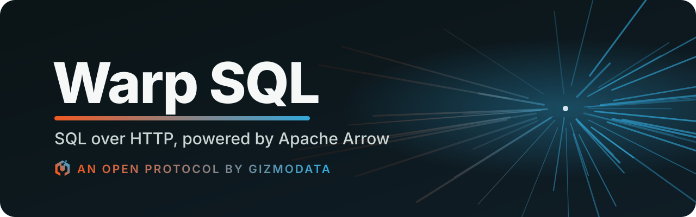
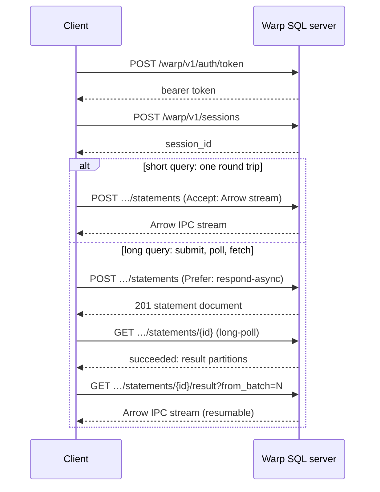

<p align="center">
  <a href="spec/warp-sql.md">
    
  </a>
</p>

<p align="center">
  <a href="spec/warp-sql.md"></a>
  <a href="conformance/tests"></a>
  <a href="spec/warp-sql.md#21-transport"></a>
  <a href="https://arrow.apache.org/docs/format/Columnar.html#ipc-streaming-format"></a>
  
  <br>
  <a href="https://github.com/gizmodata/hardcharger"></a>
  <a href="cpp/README.md"></a>
  <a href="https://github.com/gizmodata/warp-sql-adbc"></a>
  <a href="https://github.com/gizmodata/warp-sql-jdbc"></a>
  <a href="LICENSE"></a>
  <a href="https://gizmodata.com"></a>
</p>

<h3 align="center">Run SQL from anything that speaks HTTP. Get Arrow back.</h3>

---

## ⚡ What is Warp SQL?

Warp SQL is an open protocol that lets any HTTP client run SQL against a database server
and get [Apache Arrow](https://arrow.apache.org) data back: a browser `fetch`, `curl`, or
any language's standard HTTP library. No gRPC, no protobuf, no generated code.

- 🏹 **Arrow on the wire.** Results, query parameters and bulk uploads are Arrow IPC
  streams (`application/vnd.apache.arrow.stream`), so every Arrow library reads them
  directly. Control messages are small JSON documents.
- 🚀 **Short queries stay one round trip.** One `POST` runs a query and streams its result.
- 🔀 **Big results go wide.** A client can ask for a large result as several partitions and
  read them over separate connections at once, past what one TCP stream can carry, with the
  order kept when the query has one. Warp SQL's drivers do it by default (8 partitions).
- 📤 **Big uploads go wide too.** One bulk ingest can be sent as several parts over separate
  connections at once and committed as one transaction, all or nothing.
- 🌐 **Long queries survive real networks.** Submit a query, get a handle, poll it and fetch
  the result later. A dropped download resumes from the batch where it stopped, and no
  request has to outlive a proxy timeout.
- 🔐 **Safe by construction.** Every handle is bound to the identity that created it and
  checked on every use. Credentials are bearer tokens, never cookies. Results and metadata
  follow the caller's authorization.
- 🧩 **Engine-neutral and open.** Apache-2.0 licensed: any engine can implement it, and a
  black-box conformance suite tells you when you have.

## 👀 A quick look

```bash
# Get a token, open a session, run a query, read the result with pyarrow.
TOKEN=$(curl -s https://db.example.com/warp/v1/auth/token \
  -H 'Content-Type: application/json' \
  -d '{"grant_type":"password","username":"joe","password":"…"}' | jq -r .access_token)

SESSION=$(curl -s https://db.example.com/warp/v1/sessions \
  -H "Authorization: Bearer $TOKEN" -H 'Content-Type: application/json' \
  -d '{}' | jq -r .session_id)

curl -s https://db.example.com/warp/v1/sessions/$SESSION/statements \
  -H "Authorization: Bearer $TOKEN" -H 'Content-Type: application/json' \
  -H 'Accept: application/vnd.apache.arrow.stream' \
  -d '{"sql":"SELECT 42 AS answer"}' > result.arrows

python -c "import pyarrow.ipc as ipc; print(ipc.open_stream(source='result.arrows').read_all())"
```

Every server describes itself at `GET /warp`, so a client knows what it may use:

```json
{
  "protocol": "warp-sql",
  "protocol_versions": ["1"],
  "draft": "0.1.0",
  "server": {"name": "warp-duckdb", "version": "0.1.0 (DuckDB v2.0.0-dev88520)"},
  "capabilities": ["prepared_statements", "transactions", "ingest", "result_retention",
                   "long_poll", "ipc_compression_zstd"],
  "auth": {"grant_types": ["password"]}
}
```

*(Both run against `warp-duckdb`, the reference server in [`cpp/`](cpp/README.md).)*

## 🔄 How it works



## 📦 What the protocol covers

| | Spec |
|---|---|
| 🔎 Discovery, health and capabilities | [§3](spec/warp-sql.md#3-discovery-and-health) |
| 🔑 Token sign-in (password, token exchange), browser sign-in | [§4](spec/warp-sql.md#4-authentication) |
| 🗂️ Sessions with options, and transactions | [§5](spec/warp-sql.md#5-sessions) |
| ▶️ Statements: streamed or submit/poll/fetch, positional and named bind parameters | [§6](spec/warp-sql.md#6-statements) |
| ♻️ Retained, resumable results; errors mid-stream; idempotent submission | [§6.5–6.7](spec/warp-sql.md#65-retention-and-resumption) |
| 🛑 Cancellation (statement and session) and timeouts | [§6.8–6.9](spec/warp-sql.md#68-cancel-and-close) |
| 🔀 Partitioned results, read concurrently over several connections, in order or not | [§6.10](spec/warp-sql.md#610-partitioned-results) |
| 🧪 Prepared statements with JSON or Arrow parameter batches | [§7](spec/warp-sql.md#7-prepared-statements) |
| 📥 Streaming bulk ingest, with zstd | [§8](spec/warp-sql.md#8-bulk-ingest) |
| 📤 Partitioned ingest: one upload over several connections, committed atomically | [§8.3](spec/warp-sql.md#83-partitioned-ingest) |
| 🔐 Security model: principals, bound handles, governed results | [§9](spec/warp-sql.md#9-security) |
| 📚 Metadata with Flight SQL's result schemas, so driver code carries over | [§10](spec/warp-sql.md#10-metadata) |
| ⚠️ Problem-document errors and graceful shutdown | [§11](spec/warp-sql.md#11-errors) |
| 🧭 Versioning rules | [§12](spec/warp-sql.md#12-versioning) |

Results are described as **partitions**, each with a location. Today a server splits a large
result into partitions on itself, so a client reads it over several connections at once
(§6.10). Tomorrow a distributed engine can point partitions at other machines, without changing
the protocol ([docs/distributed.md](docs/distributed.md)).

## 🌍 Implementations

| | Project |
|---|---|
| Server | [**Hardcharger**](https://github.com/gizmodata/hardcharger): GizmoData's DuckDB 2.0 server |
| Reference server | [`warp-duckdb`](cpp/README.md) (this repo): DuckDB 2.0 through its v2 C API; for testing and development only, not production |
| Server SDK | [`libwarpsql`](cpp/README.md) (C++20, this repo): engines implement a `Backend`; the SDK owns authentication, handle binding, retention, cancellation and draining, and streams every result through an asynchronous pipeline (produce, compress on a worker pool, encrypt and send, each stage overlapped) |
| ADBC driver | [`warp-sql-adbc`](https://github.com/gizmodata/warp-sql-adbc): Go, with Python bindings, loadable by any ADBC driver manager |
| JDBC driver | [`warp-sql-jdbc`](https://github.com/gizmodata/warp-sql-jdbc): one jar for Java 17+, no gRPC or Netty |
| JavaScript client | [`warp-sql-js`](https://github.com/gizmodata/warp-sql-js): `@gizmodata/warp-sql`, TypeScript over plain `fetch` and Arrow JS, for Node, browsers, Deno, Bun and Cloudflare Workers |

### JavaScript

A Warp SQL server needs nothing but `fetch` from JavaScript. With
[`@gizmodata/warp-sql`](https://github.com/gizmodata/warp-sql-js), rows come back as an Arrow JS
Table (or stream batch by batch), and resumable downloads, idempotent retries, cancellation
through an `AbortSignal` and split results come with it:

```js
import { connect } from "@gizmodata/warp-sql";

const conn = await connect({ url: "warp://localhost:31337?tls=false", username: "joe", password: "s3:cret" });
const table = await conn.query("SELECT 42 AS answer, ? AS greeting", ["hello"]);
console.log(table.toArray().map((row) => row.toJSON()));
await conn.close();
```

```text
[ { answer: 42, greeting: 'hello' } ]
```

*(Run against `warp-duckdb --username joe`, with `WARP_DUCKDB_PASSWORD='s3:cret'`.)*

## ✅ Conformance

The suite in [`conformance/`](conformance/tests) is black-box: it talks to a server only
through the protocol, so any implementation can run it. It starts the server itself (and
fails, never skips, without one):

```bash
cd conformance
uv venv .venv && uv pip install --python .venv/bin/python -e .
WARP_SQL_TEST_SERVER_BINARY=../cpp/build/warp-duckdb .venv/bin/python -m pytest -q
```

For another server, tell the suite which variable carries its administrator's password
(`WARP_SQL_TEST_SERVER_PASSWORD_ENV`), the user name (`WARP_SQL_TEST_SERVER_USERNAME`) and
the flag naming its client CA for the mutual-TLS tests (`WARP_SQL_TEST_SERVER_MTLS_FLAG`,
default `--tls-client-ca`; the other `--mtls-*` flags are the same on every server), or point
it at a running server with `WARP_SQL_TEST_URL` (and `-m "not mtls"`: those tests start
servers of their own).

## 🛠️ Build the SDK and reference server

```bash
cd cpp
./scripts/build-duckdb.sh     # DuckDB 2.0 at the pinned commit
./scripts/build-arrow.sh      # Arrow C++, IPC only
OPENSSL_ROOT_DIR=$(brew --prefix openssl@3) cmake -S . -B build -G Ninja
cmake --build build
WARP_DUCKDB_PASSWORD='…' ./build/warp-duckdb --database my.duckdb --port 31337
```

See [cpp/README.md](cpp/README.md) for TLS, mTLS and the other options.

## 🗺️ Status and roadmap

**Draft 0.1.0.** The protocol is designed in the open, and may still change until 1.0.0.

1. ~~Spec draft.~~
2. ~~Spike: which Arrow library does the IPC, checked value by value for every DuckDB
   type.~~ Arrow C++ with IPC only ([results](spikes/duckdb-arrow-ipc/README.md)).
3. ~~Reference server SDK (C++) and conformance suite.~~
4. ~~ADBC (Go, Python) and JDBC drivers.~~
5. ~~A production server on the SDK~~: [Hardcharger](https://github.com/gizmodata/hardcharger),
   which runs GizmoSQL 1.x's test battery over Warp SQL alone.
6. ~~Parallel multi-partition results~~ (§6.10, with the SDK's pipelined streaming).
7. ~~A JavaScript client~~ ([warp-sql-js](https://github.com/gizmodata/warp-sql-js)) and ~~partitioned uploads~~ (§8.3).
8. Spec 1.0.0: [Appendix A](spec/warp-sql.md#appendix-a-open-items-before-10) lists the open items.

## 📂 In this repo

| Path | What |
|---|---|
| [`spec/warp-sql.md`](spec/warp-sql.md) | The protocol specification |
| [`docs/server-sdk.md`](docs/server-sdk.md) | Design of the C++ server SDK |
| [`docs/distributed.md`](docs/distributed.md) | How partitioned results leave room for distributed query |
| [`docs/gizmosql-parity.md`](docs/gizmosql-parity.md) | How GizmoSQL 1.x's Flight SQL surface maps onto Warp SQL |
| [`cpp/`](cpp/README.md) | `libwarpsql` and `warp-duckdb` |
| [`conformance/`](conformance/tests) | The conformance suite |
| [`CHANGELOG.md`](CHANGELOG.md) | Changes by version |

## 🏹 Relationship to Apache Arrow

Warp SQL is an independent project; it is not part of, or endorsed by, the Apache
Software Foundation. It uses the Arrow IPC format and borrows Arrow Flight SQL's
metadata schemas so existing driver code carries over. The Arrow community's
[HTTP data transport work](https://github.com/apache/arrow-experiments/tree/main/http)
is the reference for how Arrow streams should travel over HTTP.

Apache Arrow, Arrow, Apache, the Apache logo, and the Apache Arrow project logo are
either registered trademarks or trademarks of The Apache Software Foundation in the
United States and other countries.

## 📄 License

Apache License 2.0; see [LICENSE](LICENSE).

---

<p align="center">
  <a href="https://gizmodata.com"></a><br>
  <sub>Warp SQL is developed by <a href="https://gizmodata.com">GizmoData</a></sub>
</p>
